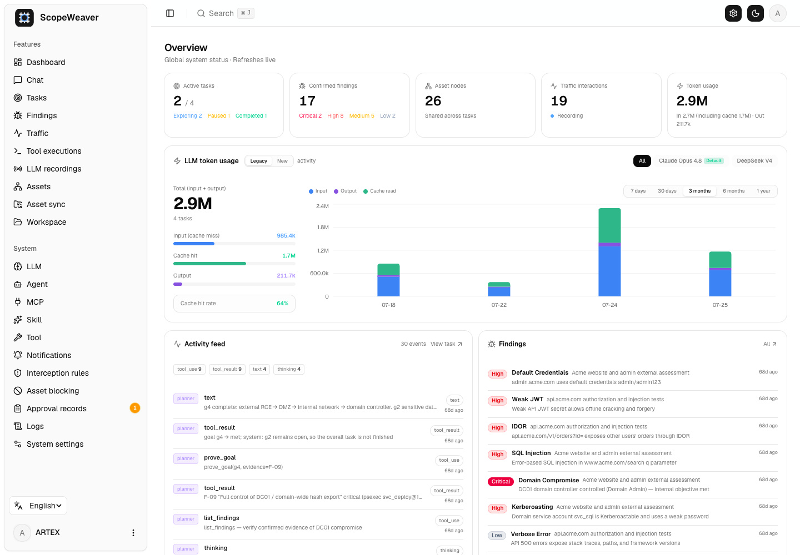
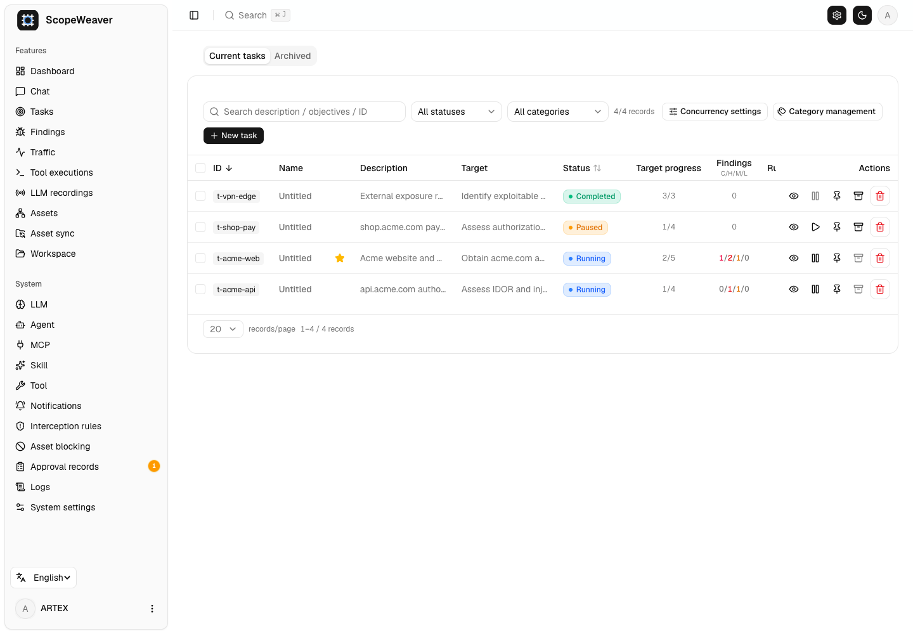
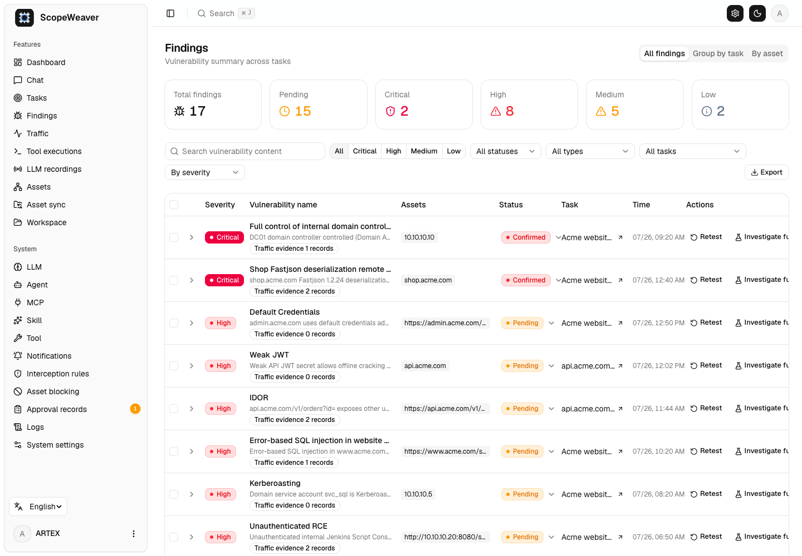
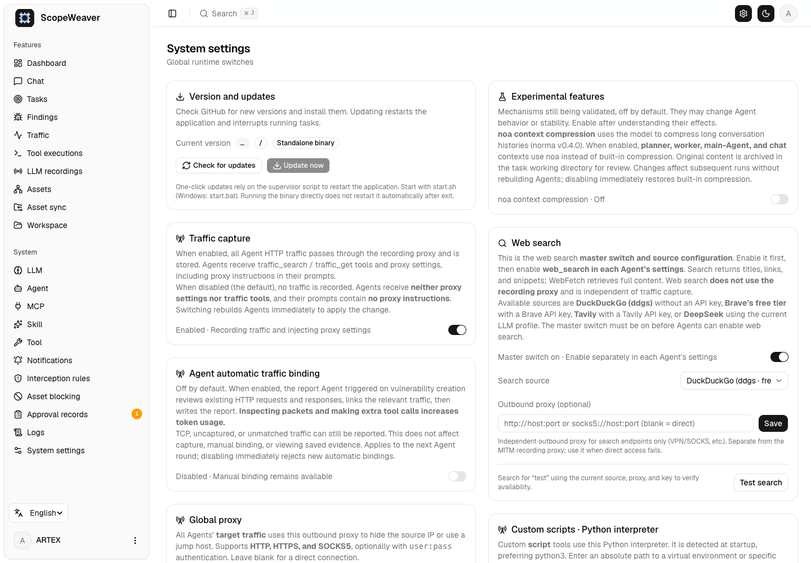
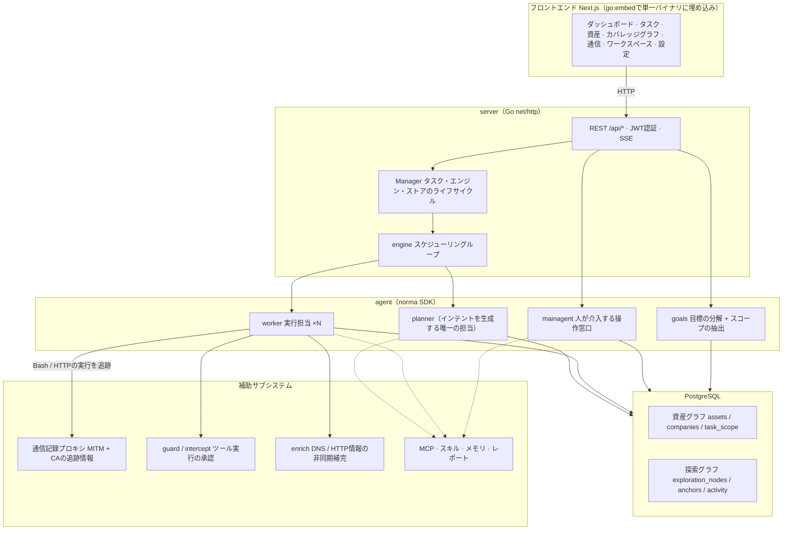
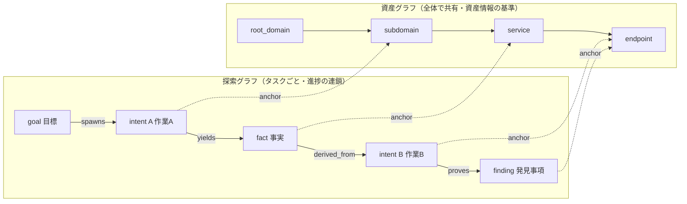
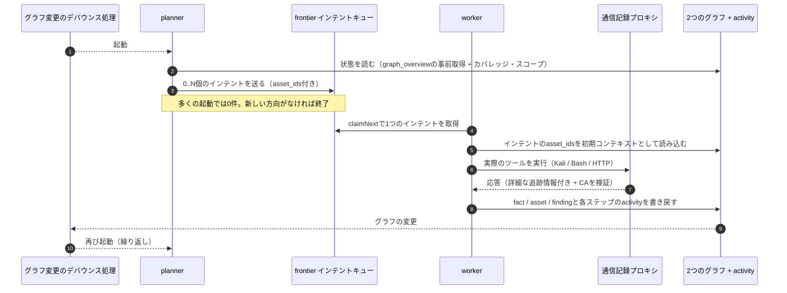
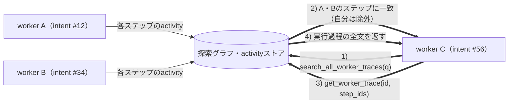
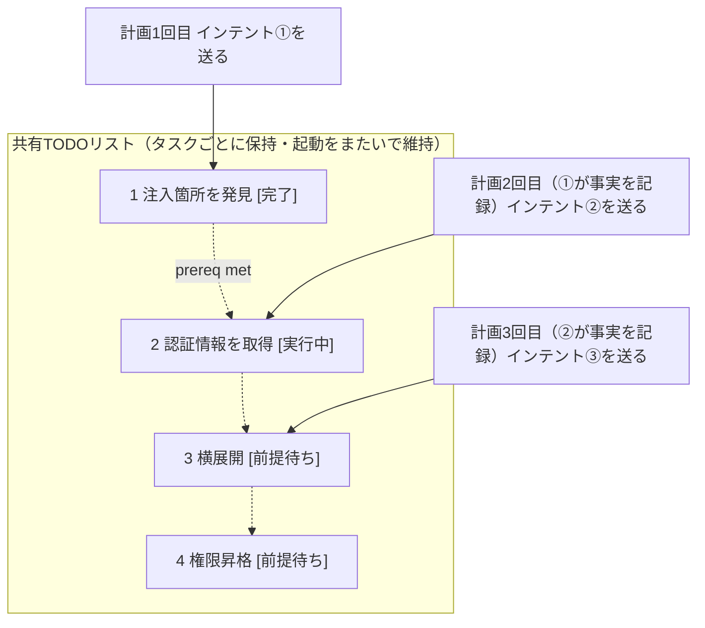

<div align="center">

# ScopeWeaver

LLMと複数のエージェントを使い、ペネトレーションテストを自律的に進めるシステム（Goバックエンド + Next.jsフロントエンド）

[English](README.md) · [한국어](README.ko.md) · 日本語

</div>

この文書は[英語README](README.md)の日本語訳です。日本語UIを追加するものではありません。画面の対応言語は[言語](#言語)を参照してください。

---

> **このプロジェクトについて。** ScopeWeaverは[Autumn-27/ARTEX](https://github.com/Autumn-27/ARTEX)を基に、名称を変更し、英語・韓国語に翻訳した派生プロジェクトです。派生元のコミットは`160fe13`です。

変更日：**2026-10-02**。これはリリースタグの日付ではありません。[派生元と変更内容](docs/PROVENANCE.md)を参照してください。

[検証状況と既知の制約](docs/VERIFICATION.md)も確認してください。

> コードとアーキテクチャはARTEXに由来します。この独立した派生プロジェクトでは、製品名、英語・韓国語の画面とメッセージ、文書、配布先を変更しています。派生元との差分は[派生元と変更内容](#派生元と変更内容)に記載しています。[ライセンスと免責事項](#ライセンスと免責事項)の条件は変更していません（AGPL-3.0）。
>
> **実行許可について。** このツールはセキュリティテスト用です。自分が所有するシステム、または明示的なテスト許可を得たシステムだけを対象にしてください。派生元の利用制限も引き続き適用されます。後述の条件を必ず確認してください。

---

## 言語

既定の言語は英語です。画面では英語、韓国語、簡体字中国語（`zh-Hans`）を選択できます。
`zh`、`zh-CN`、`zh-SG`は簡体字中国語として扱います。`Hans`を明示したタグは、繁体字圏の地域指定を含んでいても簡体字を維持します。
未定義の繁体字タグ（`zh-Hant`、`zh-TW`、`zh-HK`、`zh-MO`）は簡体字に置き換えず、次の言語候補を評価します。
詳細は[言語対応の開発者向けガイド](web/src/i18n/README.md)を参照してください。
サーバーの既定言語はシステム設定の`language`に保存します。`SCOPEWEAVER_LANGUAGE`（または`ARTEX_LANGUAGE`）は環境変数によるフォールバックです。OSの`LANG`ではアプリケーションの言語は変わりません。

リクエストの言語は、`lang`、`Accept-Language`内の対応言語、`scopeweaver_locale` Cookie、サーバーの既定言語の順で決まります。
HTTP経由で新しく作成したタスクは、キュー内で待機している間も再起動後も言語を保持します。言語が保存されていない既存タスクは、サーバーの既定言語を使います。
組み込みエージェントの指示と出力指示には実行時の言語を使い、ユーザーが編集したテンプレートや保存済みの証拠は変更しません。
レポート・CSV・ZIP内のラベルは、エクスポートを要求したときの言語に従います。[文書一覧](docs/README.md)と[韓国語の参照文書](docs/ko/README.md)には、同梱スキルの利用手順もあります。

## スクリーンショット

以下は、同梱の架空デモデータを使った英語UIの画面です。実在する対象をスキャンした結果ではありません。
[韓国語の画面](README.ko.md#스크린샷)と[モバイル画面](screenshots/en/mobile.png)も参照できます。

| ダッシュボード | タスク |
| :---: | :---: |
|  |  |
| 発見事項 | 設定 |
|  |  |

元の中国語の画面は[スクリーンショットのディレクトリ](screenshots)に残しています。出典は[派生元ARTEX](https://github.com/Autumn-27/ARTEX/tree/160fe13c243be361eeac5408c40a96e824fa842c/screenshots)です。

---

## 承認記録

「Approval records」（承認記録）画面では、記録を展開して詳細を確認できます。
タスク内の「Interception approval」（実行を保留した操作の承認）パネルや、会話内の承認カードでも同じように確認できます。
表示には[AegisHookの承認詳細コンポーネント](https://github.com/RuoJi6/AegisHook/blob/main/web/src/components/CallDetail.vue)と、そのテーマを再利用しています。

## 資産同期（ScopeSentry）

[ScopeSentry](https://github.com/Autumn-27/ScopeSentry)から資産データを直接同期できるため、同じ情報を収集し直す手間を省けます。

- 「Asset sync」（資産同期）画面でScopeSentryのアドレスとAPIキーを入力し、データソースに接続します。
- プロジェクト単位またはタスク単位で同期対象を選び、資産の種類（ドメイン、サブドメイン、IP、ポート、サイト、エンドポイントなど）を指定します。
- インポートすると、資産は企業の資産スコープに統合され、エージェントが探索する資産グラフに反映されます。

---

## インストール

### GLMなどのモデルプロバイダー

「LLM → New」には、Z.aiのGeneral API向けGLM-5.3設定テンプレートと、区別して表示されたCoding Planの参考設定があります。
自分のAPIキーを設定してください。テンプレートを選択しただけでは、保存、有効化、プロバイダーへの接続は行いません。
Coding Planは公式に対応するツールでのみ利用でき、ScopeWeaverはその一覧に含まれていません。[プロバイダー設定とサポート範囲](docs/llm-providers.md)を確認してください。
クラウドのトークン使用量を抑える方法は[トークン使用量の制御](docs/llm-providers.md#controlling-token-use)を参照してください。

OllamaのネイティブAPIを使うプロファイルも選べます。APIキーは不要です。
同じマシンのOllama、Dockerからホスト上のOllama、任意で有効にする`docker compose --profile local-llm`サービスの3種類のテンプレートがあります。
選択するとインストール済みモデルを取得し、ツール対応を宣言しているモデルを優先して入力します。モデルのダウンロードや起動は行いません。
コンテキストは32K（`num_ctx` 32,768）、同時リクエストは1件、モデルの保持時間は30分です。

任意の「local-only LLM network」（LLM通信をローカルに限定）設定は、既定では無効です。有効にすると、ループバックと明示的に信頼した推論先のCIDRだけにLLM通信を許可します。LANやDockerのアドレスも許可リストへの登録が必要です。
エージェントのWeb検索と更新確認・ダウンロードもすべて遮断しますが、ローカルでのバージョン確認とロールバックは利用できます。
**テスト対象に接続するツールのネットワーク通信は遮断しません。** ホストやリモートで動くOllamaには、別途`OLLAMA_NO_CLOUD=1`を設定してください。
この制限を有効にしていない場合は、クラウド形式、任意のURL、プロキシも引き続き使えます。
ネイティブAPIでは、待機中の判定用エージェント（judge）、メインエージェント、追加質問のリクエストに、次に空いた処理枠を割り当てます。ネイティブjudgeの既定の制限時間は1回の問い合わせにつき90秒で、コンテキスト量にも上限を設けています。
詳細は[OllamaのネイティブAPIによるローカル推論](docs/llm-providers.md#native-ollama-local-inference)を参照してください。

> データベースに**PostgreSQL**が必要です。探索を実行するにはLLMの設定も必要です（`ANTHROPIC_API_KEY`、`OPENAI_API_KEY`、APIキー不要のOllamaプロファイル、または画面から設定）。

### 方法1：インストールスクリプト（推奨）

```bash
git clone https://github.com/cskwork/scopeweaver.git
cd scopeweaver
./install.sh
```

スクリプトはDockerを検出し、必要な場合はインストールするか選択できます。
その後、「①すべてDockerで実行」か「②ローカルでビルドして実行」を選びます。

- **①すべてDockerで実行**：Postgresのパスワードを入力します。Enterだけを押すとランダムに生成します。`.env`を作成し、`docker compose up -d`で起動します。
- **②ローカルで実行**：既存のデータベースに接続するか、Dockerで新しく起動します。`config.json`を生成し、Goでフロントエンドを埋め込んだ単一バイナリをビルドして起動します。

起動したら**http://localhost:8787**を開きます。初回は`/setup`で管理者パスワードを設定します。

> スクリプトの表示言語は既定で英語です。韓国語で表示するには、実行前に`SCOPEWEAVER_LANGUAGE=ko`（または`ARTEX_LANGUAGE=ko`）を指定します。例：`SCOPEWEAVER_LANGUAGE=ko ./install.sh`。

### 方法2：Docker Composeを手動で実行

```bash
git clone https://github.com/cskwork/scopeweaver.git
cd scopeweaver
cp .env.example .env          # set POSTGRES_PASSWORD, optionally ANTHROPIC_API_KEY
docker compose up -d --build  # builds the scopeweaver image locally + postgres
# → http://localhost:8787
```

> 既定のComposeファイルは、このソースからイメージをローカルでビルドします。`ghcr.io/cskwork/scopeweaver`で公開されているリリースイメージを使う場合は、Composeでそのバージョンを明示的に指定してください。

イメージにはripgrep、curl、vim、npm、nmapなどの一般的なツールが含まれます。`./skills`と`./data`はバインドマウントし、データを保持します。

リモートMCPには、システム設定で`http`（Streamable HTTP）または`sse`（従来のSSE）を指定できます。
従来のSSEサーバーは通常、`GET /sse`でイベントストリームを開き、返された`/message?sessionId=...`でJSON-RPCリクエストを受け取ります。URLを`/sse`、ヘッダーを`Authorization=Bearer <token>`に設定してください。

### 方法3：ビルド済みバイナリをダウンロード（Releases）

> [Releases](https://github.com/cskwork/scopeweaver/releases)から、利用する環境のアーカイブをダウンロードします。
> ファイル名は`scopeweaver-<version>-<os>-<arch>.zip`です。展開すると、`scopeweaver`、`start.sh`（Windowsでは`start.bat`）、`skills/`、`config.example.json`が得られます。

アーカイブには`adapters/agent/`も含まれます。[エージェント連携の設定手順](adapters/agent/README.md)を参照してください。

```bash
cp config.example.json config.json   # fill in the database connection
./start.sh                            # → http://localhost:8787
```

> 起動には`start.sh`または`start.bat`を使ってください。これらはプログラムの終了コードに応じて再起動を判断する監視スクリプトです。[アプリ内からの更新](#方法1アプリ内から更新推奨)も、この仕組みを使って新しいバイナリに切り替えます。`./scopeweaver`を直接実行した場合は、更新後に自動で再起動しません。
> バックグラウンドで実行する場合：`nohup ./start.sh >scopeweaver.log 2>&1 &`。

### 方法4：ソースから単一バイナリをビルド

```bash
# 1) export the frontend as static files
cd web && npm ci && npm run build:static && cd ..
# 2) copy it into the embed directory
mkdir -p server/webui/dist
cp -R web/out/. server/webui/dist/
# 3) build (the embedui tag embeds the frontend)
CGO_ENABLED=0 go build -tags embedui -o scopeweaver ./cmd/artex
./start.sh
```

> 派生元との互換性のため、ビルド元のパスは`./cmd/artex`、Goモジュールは`github.com/Autumn-27/artex`のままです。出力するバイナリだけを`scopeweaver`という名前にしています。

### 方法5：複数環境向けのリリースアーカイブをビルド

`build.sh`はフロントエンドをビルドしてバイナリに埋め込み、Goリンカーでデバッグ情報を除去して、各環境のリリースをZIPにまとめます。
リリースモードの既定の対象は、Linux amd64/arm64、macOS amd64/arm64、Windows amd64です。

アーカイブには、同梱のshadcnスタイルシートに関する`THIRD_PARTY_NOTICES.txt`を含めています。コンテナイメージにも、同じ通知を`/app/THIRD_PARTY_NOTICES.txt`に保存しています。

```bash
./build.sh --release
# output: dist/scopeweaver-0.3.3-*.zip
```

UPXで圧縮した自己展開バイナリは、一部のLinuxカーネル、仮想化環境、セキュリティポリシーと衝突する場合があるため、UPXは既定で無効です。
ビルド対象は`ARTEX_TARGETS`で変更できます。実行環境との互換性を確認した場合だけ、`--upx`を明示的に指定してください。

```bash
ARTEX_TARGETS=linux/amd64,windows/amd64 ./build.sh --release
./build.sh --target linux/amd64 --upx
```

### リバースプロキシ経由で公開する場合

本番用ビルドは、UI、API、SSEによるリアルタイムのイベントストリームを同じオリジンから提供します。
HTTPSの443番ポートを公開し、バックエンドのポートは非公開にできます。
イベントがブラウザに届くよう、プロキシのバッファリングを無効にし、長時間の接続を許可してください。

```nginx
location / {
    proxy_pass http://127.0.0.1:8787;
    proxy_set_header Host $host;
    proxy_set_header X-Forwarded-Proto $scheme;
    proxy_http_version 1.1;
    proxy_set_header Connection "";
    proxy_buffering off;
    proxy_cache off;
    proxy_read_timeout 3600s;
}
```

SSEを別のオリジンから提供する場合に限り、ビルド時に`NEXT_PUBLIC_SSE_BASE`を設定します。
コンテナの実行時に変更しても、エクスポート済みのフロントエンドには反映されません。
`next dev`では、Next.jsのバッファリングを避けるため、SSEは8787番ポートに直接接続します。`NEXT_PUBLIC_SSE_BASE`に空文字列を明示すると、同じオリジンを使います。

---

## 更新

> 更新で置き換えるのはプログラムだけです。Postgresのボリューム`pgdata`、`./data`（jwt.key、SQLiteなど）、`./skills`は保持します。
> データベースのマイグレーションは起動時に自動で実行します。`schema.sql`は、何度適用しても変更が重複しないようになっています（`ADD COLUMN`、`CREATE INDEX IF NOT EXISTS`を含む）。そのため、再起動するとスキーマも更新されます。ただし、アップグレード前には`./data`とデータベースをバックアップしてください。

### 方法1：アプリ内から更新（推奨）

サイドバーの「System configuration」（システム設定）から`/system/settings`を開きます。
「Version and updates」（バージョンと更新）カードで、サーバーにログインせずに新しいバージョンを確認・インストールできます。

「Update」を押すと、利用環境に対応するリリースをダウンロードし、そのリリースの`SHA256SUMS`と照合します。
続いて新しいバイナリを`-h`で試しに起動し、`scopeweaver.new`として配置します。
プログラムが終了すると、`start.sh`または`start.bat`が再起動して置き換えを完了します。画面は新しいバージョンの起動を待ってから再読み込みします。

- **更新に失敗した場合**：照合や起動確認に失敗すると、準備したファイルを破棄し、現在のプログラムを使い続けます。置き換え後の起動に3回続けて失敗すると、自動で`scopeweaver.old`に戻します。失敗したバイナリは調査用に`scopeweaver.failed`として残します。
- **以前のバージョンに戻す場合**：以前のバイナリは`scopeweaver.old`に保存します。カードの「Roll back to previous version」から戻せます。ただし、データベースのスキーマは元に戻りません。
- **実行中のタスクへの影響**：更新では再起動が発生し、実行中のタスクを中断します。タスクが動いていないときに更新してください。
- **開発用ビルド**：バージョンが`dev`、または末尾に付加情報のある`git describe`形式の場合は更新を無効にします。ローカルでビルドしたデバッグ用バイナリをリリースで上書きしないためです。
- **Dockerでの更新**：変更するのはプログラムだけで、イメージ内のPlaywrightやnmapなどのツール群は更新しません。`docker compose up -d`でコンテナを再作成すると、イメージに含まれるバージョンに戻ります。公開イメージがある場合にイメージも更新するには、`docker compose pull scopeweaver && docker compose up -d scopeweaver`を使います。公開イメージがない場合は`docker compose up -d --build scopeweaver`を使ってください。
- **GitHubへの接続にプロキシが必要な場合**：同じ画面でグローバルプロキシを設定すると、更新時にも使います。ダウンロード先はGitHubのドメインに限定し、HTTPSを必須にしています。

### 方法2：更新スクリプト

```bash
cd scopeweaver
./update.sh
```

スクリプトでは最初に`git pull`を実行するか選べます。その後、`install.sh`と同じように「①Dockerで更新」か「②ローカルビルドで更新」を選びます。

- **①Docker**：現在のチェックアウトを`docker compose build scopeweaver`でビルドし直し、`docker compose up -d scopeweaver`でサービスを再作成します。
- **②ローカル**：フロントエンドを静的ファイルとしてビルドし直し、`./scopeweaver`を再ビルドします。反映にはプロセスの再起動が必要です。

### 方法3：Docker Composeを手動で実行

```bash
cd scopeweaver
git pull                       # update compose / scripts (optional)
# To pin a source version, check out a reviewed tag or commit before building.
docker compose up -d --build scopeweaver   # rebuild from source and restart → auto-migrate schema
docker image prune -f          # clean up old images (optional)
```

> 公開イメージがあり、Composeでもそのイメージを明示的に指定している場合は、ビルドの手順を`docker compose pull scopeweaver && docker compose up -d scopeweaver`に置き換えてください。

### 方法4：ビルド済みバイナリ（Releases）

新しい`scopeweaver-<version>-<os>-<arch>.zip`をダウンロードし、実行中のプロセスを停止します。
`config.json`と`data/`を保持したまま`scopeweaver`と`skills/`を上書きし、再起動してください。

```bash
cp -r <unpacked>/skills ./ && cp <unpacked>/scopeweaver ./
./start.sh
```

### 方法5：ソースからビルド

```bash
git pull
cd web && npm ci && npm run build:static && cd ..
cp -r web/out server/webui/dist
CGO_ENABLED=0 go build -tags embedui -o scopeweaver ./cmd/artex
# restart ./start.sh
```

---

## 設定

### コーディングエージェントとの連携

Claude Code、Codex、Piから、[エージェント連携アダプター](adapters/agent/README.md)を通じてタスクを作成し、進捗、カバレッジ、発見事項を取得できます。
Claude CodeとCodexはローカルのstdio MCPを、Piはネイティブ拡張を使います。
読み取りは既定で有効です。タスク作成、一時停止、再開は、設定で明示的に有効にします。
アダプターは既存の認証付きAPIを使うため、ScopeWeaver内部のエージェントとモデル設定は変わりません。

**データベース**は`config.json`で設定します。環境変数`ARTEX_PG_DSN`で上書きすることもできます。

```json
{
  "database": {
    "host": "127.0.0.1", "port": 5432,
    "user": "artex", "password": "yourpass",
    "dbname": "artex", "sslmode": "disable"
  }
}
```

> 派生元との互換性のため、設定項目と環境変数の`ARTEX_*`接頭辞、およびデータベースの既定値`artex`は維持しています。明記している箇所では、スクリプトで`SCOPEWEAVER_*`の別名も使えます。

**LLM**は、`export ANTHROPIC_API_KEY=sk-...`（または`OPENAI_API_KEY`）か、画面の「LLM configuration」で設定します。
必要に応じて、`ARTEX_LLM_PROVIDER`、`ARTEX_LLM_MODEL`、`ARTEX_LLM_BASE_URL`、`ARTEX_LLM_PROXY`も指定できます。
`SCOPEWEAVER_LLM_*`の各別名は、対応する`ARTEX_LLM_*`より優先されます。Ollamaでは末尾が`CONTEXT_WINDOW_K`、`MAX_CONCURRENT`、`KEEP_ALIVE`、`MAX_TOKENS`の項目も使えます（[全項目](docs/llm-providers.md#environment-and-configuration)）。

**同時実行数**は、「System settings」でタスクごとの作業エージェント数を指定します。既定値は3です。

**主な起動オプション**：`./start.sh -addr :8787 -proxy :8788`。`-addr`はフロントエンドとAPI、`-proxy`は通信を記録するプロキシの待ち受け先です。起動スクリプトはこれらのオプションをそのまま`scopeweaver`に渡します。

---

## 開発

貢献を歓迎します。要件、検証方法、PRのレビュー・マージ手順は[CONTRIBUTING.md](CONTRIBUTING.md)を参照してください。

### 脆弱性の手動再検証

タスク詳細の「Retest」（再検証）タブには、そのタスクの脆弱性がページごとに表示されます。過去の判定と証拠を確認し、手動で再検証を開始できます。
開始後も現在のタブを維持し、処理中の表示と「Retesting」を出します。修正を確認すると、脆弱性の状態を更新します。

脆弱性一覧の行にある「Retest」、または脆弱性詳細の「Retest」欄にある「Start retest」を押してください。
修正バージョン、検証条件、制約は任意で入力できます。専用の再検証エージェントのセッションを作成し、画面は移動しません。
一覧、タスク別、資産別の各表示から開始できます。実行中は「Retesting」と処理中の表示に変わり、開くとセッションを確認できます。終了すると「Retest」に戻ります。
元のスキャンタスクを再起動することはありません。
判定は「Still reproducible」（引き続き再現）、「Fixed」（修正済み）、「Cannot confirm」（確認できず）のいずれかです。判定、証拠、セッションへのリンクを脆弱性詳細に保存します。

新しいバックエンドは、初回起動時に編集可能な脆弱性再検証エージェント（`retester`）を作成します。
エージェント管理で、プロンプト、LLM、実行予算、ツールを設定できます。通常は紐づけたLLMを使い、指定がなければ全体で有効なLLM設定を使います。
再検証セッションが正常に終了し、判定が「Fixed」になった場合は、脆弱性の対応状態を自動で「Fixed」に変更します。実行中、失敗、停止、その他の判定では、元の状態を維持します。
元の証拠とレポートは常に保持します。状態の選択欄から手動で「Fixed」にすることもできます。

このバージョンの再検証履歴は、脆弱性詳細とセッションで確認できます。脆弱性レポートのエクスポートとタスクアーカイブにはまだ含まれず、通信記録との自動紐づけも行いません。
デモモードでは、模擬記録と明示したデータだけを作り、実在する対象には接続しません。

### ローカルでの実行とテスト

```bash
./dev.sh    # backend(:8787) + traffic proxy(:8788) + frontend next dev(:5173) → http://localhost:5173
```

- バックエンド：`go run ./cmd/artex`。`-tags embedui`なしではフロントエンドを埋め込みません。
- フロントエンド：`cd web && npm run dev`。`/api`をバックエンドへリバースプロキシし、ホットリロードに対応します。
- テスト：`go test ./...`。
- モック表示（バックエンド不要）：`cd web && NEXT_PUBLIC_MOCK=1 npm run dev`。

---

## アーキテクチャ

ScopeWeaverは、ARTEXを基にした、LLMによる複数エージェント型の自律ペネトレーションテストシステムです。
Next.jsフロントエンドを埋め込んだ単一のGoバックエンドと、PostgreSQLで構成します。
エージェントの機能には[`norma`](https://github.com/Autumn-27/norma) SDK（`agentcore`、`tool`、`permission`、`harness`、`memory`、`transcript`）を使います。
中心となるのは、資産と探索経過を分けて記録する2つのグラフです。
その上で、実行担当のワーカー同士が実行過程の情報を共有し、計画担当のプランナーが複数回の計画にまたがる共有TODOリストで攻撃手順の依存関係を管理します。

### レイヤー構成



| レイヤー | 役割 |
| --- | --- |
| **Frontend** | Next.jsの静的エクスポートを`go:embed`で単一バイナリに埋め込みます。タスク、資産、探索、カバレッジを可視化し、人が介入できるチャットを提供します。 |
| **server** | `net/http`のルーティング、JWT認証、SSEを提供します。`Manager`がタスク、エンジン、DBストアのライフサイクルを管理します。 |
| **engine** | タスクごとに1つの`plannerLoop`とN個のワーカーgoroutineを実行します。インテントの取得、タイムアウト、一時停止、処理の終了待ちを管理します。 |
| **agent** | goals、planner、worker、mainagentを提供します。`ToolSet`を通じて、2つのグラフをLLMツールとして操作できます。 |
| **db** | pgxで2つのグラフをPostgresに保存します。`go:embed`で埋め込んだスキーマを、起動のたびに再適用できる形で作成します。 |
| **support** | 通信を記録するMITMプロキシ、実行承認、情報の非同期補完、MCP、スキル、メモリ、レポートを提供します。 |

### 資産グラフと探索グラフを分けて記録

「対象が何か」と「どこまで検証したか」を別々のグラフに保存し、アンカーで結びます。

- **資産グラフ（全タスクで共有）**：タスクをまたいで参照する、資産情報の基準となる記録です。ノードは`root_domain / subdomain / ip / service / app / endpoint`で、それぞれが企業に属します。ドメイン→サブドメイン→サービス→エンドポイントの親子関係と重複排除キーは、プログラムが計算します。エージェントは加工前の観測結果だけを渡します。
- **探索グラフ（タスクごと）**：1つのタスクの思考過程と進捗を記録します。`goal / intent / fact / finding / hint`のノードを`spawns / derived_from / yields / proves`の辺で結び、どの事実からどの検証方針を導き、何が得られたかを追える履歴にします。ここで`intent`（インテント）は、ワーカーが実行する1つの作業単位です。
- **アンカーで2つのグラフを接続**：`exploration_anchors(node_id, asset_id)`で、インテント、事実、発見事項を特定の資産に紐づけます。ある検証方針がどの資産を調べているか、また、ある資産をこのタスクのどのインテントが検証して何を得たかをたどれます。資産のテストカバレッジと、スコープ内の資産・テスト済みの資産を示すカバレッジグラフも、この関係を使います。



> **役割分担**：プランナーは探索グラフの状態を読み、目標の達成状況を判定します。未検証の新しい方向があるときだけ、実行待ちキュー（frontier）にインテントを送ります。ワーカーは1つのインテントを取得し、実際のツールを実行して、新しい資産・事実・発見事項を両方のグラフに書き戻して終了します。資産グラフは共有する事実を、探索グラフは各タスクの進捗を記録します。

### エンジンとインテントのライフサイクル

エンジンはイベントに応じて動きます。グラフの変更でプランナーが起動し、インテントを送ります。
ワーカーがインテントを取得・実行して結果を書き戻すと、その変更が次の計画を起動します。目標を立証する`prove_goal`まで、この流れを繰り返します。



### ワーカー間で実行過程の情報を共有

探索を深める過程では、エラー、レスポンス、隠れたパラメーターなど、有用な観測結果がワーカーの実行履歴だけに残り、正式な事実としては記録されないことがあります。
重複作業を避け、先行するワーカーの結果を後続の作業に使えるよう、他のワーカーの実行過程を検索できます。

- `search_all_worker_traces(q)`：このタスク内の他の作業の実行過程をキーワード検索します。自分のインテントのステップは自動で除外し、検索結果には`intent_id`を含めます。
- `list_worker_traces` / `get_worker_trace(intent_id, step_ids=[…])`：まず実行済みの作業を一覧で確認し、特定の作業の必要なステップを全文取得して、詳しい情報を参照します。

探索グラフに該当する事実がまだなくても、後続のワーカーは他のワーカーが実行中に得た観測結果を再利用できます。
各ワーカーが担当するのは取得した1つのインテントだけ、という境界を保ちながら、実行過程の情報を共有する仕組みです。



### 共有TODOリストで複数段階の攻撃手順を管理

攻撃手順には、注入箇所の発見→認証情報の取得→横展開→権限昇格のように、前の結果に依存する複数の段階があります。
すべてを一度に並列実行しないよう、プランナーはタスクごとに計画用の共有TODOリストを保持し、次に起動したときも引き継ぎます。

- プランナーはグラフの変更で起動しますが、毎回新しいセッションになります。共有TODOリストに順序のある攻撃手順を記録しておけば、1回の計画で全手順を投入せず、依存関係に従って複数回に分けてインテントを送れます。
- 各回で送るのは、前提となる作業が完了し、必要な事実がそろった次のステップのインテントだけです。進行に応じてリストを更新し、事実によって達成を確認したステップを完了にします。



これにより、イベントに応じて毎回新しいセッションで動く構成でも、同じ作業の繰り返しや順序の入れ替わりを避けながら、複数段階の攻撃手順を自律的に進めます。

---

## 派生元と変更内容

ScopeWeaverは、[Autumn-27/ARTEX](https://github.com/Autumn-27/ARTEX)のコミット`160fe13`から派生しています。
この独立した派生プロジェクトで変更した内容は次のとおりです。

- **製品名**：利用者向けの文書、スクリプト、配布物の「ARTEX」を「ScopeWeaver」に変更しました。Goモジュール（`github.com/Autumn-27/artex`）、ビルド元のパス（`./cmd/artex`）、`ARTEX_*`の設定・環境変数、データベースの既定値`artex`は、互換性のため維持しています。
- **文書の言語**：英語を既定とし、[README.ko.md](README.ko.md)と[docs/ko](docs/ko/README.md)に韓国語訳を配置しています。このREADMEの日本語訳は[README.ja.md](README.ja.md)です。
- **スクリプトの言語**：セットアップ、ビルド、起動、更新、パスワードリセットの表示は既定で英語です。`SCOPEWEAVER_LANGUAGE=ko`で韓国語を選択できます（`ARTEX_LANGUAGE=ko`も利用可能）。ネットワーク経由の翻訳は使いません。
- **配布物**：バイナリ名は`scopeweaver`、リリースアーカイブ名は`scopeweaver-<version>-<os>-<arch>.zip`です。リポジトリは`https://github.com/cskwork/scopeweaver`で、コンテナイメージの配布先はこのリポジトリのGHCRです。派生元のDocker Hubイメージ（`autumn27/artex`）は使いません。
- **ScopeWeaverのリリース履歴**：独立したリリースは`v0.1.0`から始まり、リリースノートは[log/](log/changelog-v0.1.0.md)にあります。バージョンタグを付けると、環境別アーカイブとコンテナのビルドが起動します。Docker Composeでは、公開イメージを明示的に指定しない限り、ローカルでビルドします。

[CHANGELOG.md](CHANGELOG.md)の翻訳は、派生元であるARTEXの履歴を記したものです。そこにある変更をScopeWeaverによる変更として扱っていません。

### スクリーンショットと言語別の画像

英語・韓国語の画面は`screenshots/en/`と`screenshots/ko/`にあります。同梱のデモデータを使ったデスクトップとモバイルの画面です。
`screenshots/`にある、その他のARTEXの画面は、派生元を明記した上で変更せずに残しています。

---

## 謝辞

- **派生元**：[Autumn-27/ARTEX](https://github.com/Autumn-27/ARTEX)。このプロジェクトの基となったソフトウェアです。元のコードとアーキテクチャの功績は、その著者に帰属します。
- **エージェントSDK**：[`norma`](https://github.com/Autumn-27/norma)。
- **資産同期**：[ScopeSentry](https://github.com/Autumn-27/ScopeSentry)。
- **承認詳細のUI**：[AegisHook](https://github.com/RuoJi6/AegisHook)。
- **参考プロジェクト**：[Cairn](https://github.com/oritera/Cairn)。
- **派生元のコミュニティ**：ARTEXの著者がWeChat公式アカウント「SecSentry」を運営しています。`screenshots/wx.png`はそのQRコードで、派生元の画像として保持しています。ScopeWeaverの窓口ではありません。

---

## ライセンスと免責事項

> この節は、ARTEXのライセンス、著者による利用制限、免責事項を原文に沿って訳したものです。条件は変更していません。

### オープンソースライセンス

このプロジェクトは**GNU Affero General Public License v3.0（AGPL-3.0）**で提供します。
全文はリポジトリ直下の[LICENSE](LICENSE)を参照してください。

誰でも自由に利用、改変、配布できますが、派生物もAGPL-3.0でソースコードを公開する必要があります。
特に、このプロジェクトを改変してネットワーク経由で利用者に提供する場合（ホスティングサービスなど）は、その利用者に対応する完全なソースコードを提供する必要があります。

> **重要**：オープンソースライセンス自体は、ソフトウェアの利用方法を制限しません。以下の「利用制限」と「免責事項」は、著者が利用者に示す追加の条件と方針です。遵守してください。

**ARTEXの用途は、個人学習、ソースコードの研究、ローカルでの技術検証に限ります。オンライン上のシステムやWebサイトに対する実際のテストに使ってはいけません。**

### 許可する用途

- このプロジェクトのソースコードを読み、学習・研究すること、およびローカルの隔離環境で技術的な仕組みを検証すること。
- 個人学習、学術研究、コードレビューなど、攻撃を伴わない利用。

### 禁止する用途

- このツールで、Webサイト、オンラインサービス、ネットワーク接続されたシステムをスキャン、探索、悪用、攻撃すること。実行許可の有無や、自分の所有する資産かどうかを問いません。
- 実際のペネトレーションテスト、レッドチーム・ブルーチーム演習、本番環境での利用。
- 不正侵入、データ窃取、恐喝、サービス拒否、その他の破壊行為や犯罪行為。
- 利用者の国・地域の法令に違反する利用。

### 法令遵守の責任

利用者は、自国・地域のサイバーセキュリティ、データ保護、コンピューター犯罪に関するすべての法令を遵守しなければなりません。
中国本土では、サイバーセキュリティ法、データセキュリティ法、個人情報保護法、関連する司法解釈などが該当しますが、これらに限りません。
このツールの利用から生じる法的責任とその結果は、すべて利用者が負います。

### 免責事項

このプロジェクトは「現状のまま（AS IS）」提供し、明示・黙示を問わず、いかなる保証も行いません。
利用の適否にかかわらず、このツールの利用から生じた直接的・間接的な損失、データ消失、システムの損害、法的紛争について、著者と貢献者は責任を負いません。
このプロジェクトをダウンロード、インストール、または利用することで、上記のすべての条件を読み、理解し、同意したことを確認したものとします。
