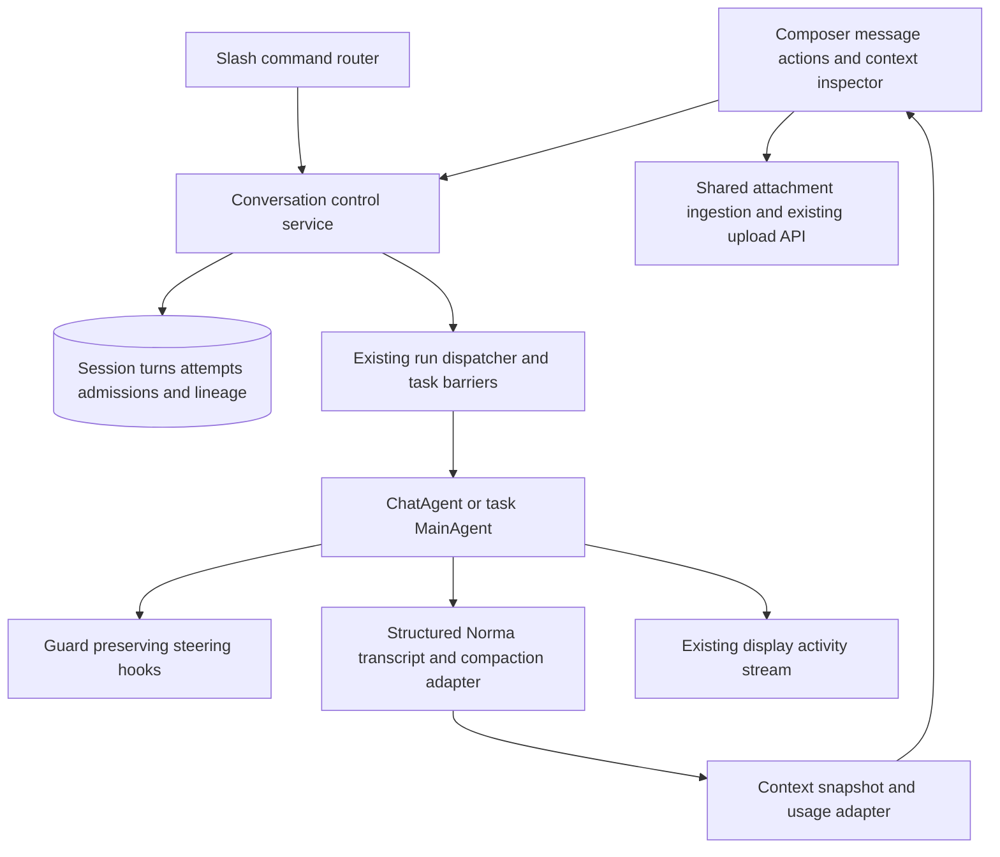

# Chat Controls and Context Design

Status: Approved for implementation planning on 2026-10-16

## Purpose and agreed scope

Give Scopeweaver chat visible controls for queued follow-ups, steering a running agent, retrying and editing prompts, branching conversations, inspecting and compressing context, and pasting documents directly into the composer. Use Hermes Agent and Hermes Desktop as the behavioral and implementation references, while retaining Scopeweaver's Go, Norma, PostgreSQL, and Next.js architecture and current visual style.

The user requested planning only, selected these features, and explicitly required a graphical interface comparable to Hermes Desktop. Every supported operation has a visible UI control; slash commands provide optional shortcuts. The design covers the standalone chat page and task MainAgent sessions. Existing Worker steering remains integrated with its current task lifecycle.

The proposed paste default follows the inspected Hermes Desktop policy: copied files become attachments, ordinary text stays inline, and plain text longer than 3,000 JavaScript string code units becomes a text attachment. Browser clipboard support determines whether an original copied file is available.

Success means users can keep composing while work runs, distinguish queued input from delivered steering, safely revisit prompts, understand which context reaches the model, and paste material without opening a file picker. Accepted queued inputs, uploaded attachments, and published conversation history survive process restart. Unsent drafts and pending uploads stay associated with their original session when the user switches chats.

Memory, conversation-wide search, new messaging gateways, autonomous skill maintenance, and additional subagent systems are outside this scope.

## Approach

| Approach | Tradeoff |
| --- | --- |
| Port Hermes lifecycle patterns into Scopeweaver, recommended | Reuses established queue, rewind, lineage, and context patterns while keeping task controls and existing model bindings coherent. Requires a shared conversation service. |
| Add controls independently to the current HTTP handlers | Smaller initial edits, but queue admission, history changes, and compression would have separate locking and recovery rules. |
| Adopt the Hermes runtime as a second backend | Provides a broader Hermes surface but introduces another runtime, credential configuration, and session lifecycle alongside Norma and task orchestration. |

Use the first approach. Adapt Hermes mechanisms at existing Scopeweaver boundaries and document differences explicitly. The runtime owns execution and admission; UI buttons and slash commands call the same server operations. Avoid implementing a second agent loop or duplicating the SDK's automatic compactor.

## References and adaptations

Hermes source references below are pinned to commit `4e59ac2b883b4133ea8a2d299abac45189781c09`.

| Area | Reference | Scopeweaver adaptation |
| --- | --- | --- |
| Desktop interaction | [Hermes Desktop guide](https://hermes-agent.nousresearch.com/docs/user-guide/desktop) | Queue above the composer, visible editing controls, persistent pending input, and a clickable context meter. Preserve current Scopeweaver components and responsive layout. |
| Queue controls | [Queue panel](https://github.com/NousResearch/hermes-agent/blob/4e59ac2b883b4133ea8a2d299abac45189781c09/apps/desktop/src/app/chat/composer/queue-panel.tsx) and [queue hook](https://github.com/NousResearch/hermes-agent/blob/4e59ac2b883b4133ea8a2d299abac45189781c09/apps/desktop/src/app/chat/composer/hooks/use-composer-queue.ts) | PostgreSQL owns queued entries and their revisions. Preserve edit, delete, resume, delivery, and lost-run acknowledgement concepts. |
| Busy composer | [Submit routing](https://github.com/NousResearch/hermes-agent/blob/4e59ac2b883b4133ea8a2d299abac45189781c09/apps/desktop/src/app/chat/composer/hooks/use-composer-submit.ts) | Hermes supports interrupt, steer, and queue policies. This scope exposes Queue and Steer, defaults to Queue while busy, and keeps Stop explicit. Interrupt-and-resend is not introduced as another mode. |
| Retry | [Session commands](https://github.com/NousResearch/hermes-agent/blob/4e59ac2b883b4133ea8a2d299abac45189781c09/gateway/slash_commands_session.py) | Rewind the active view before the last genuine user turn and resubmit it in the same session. Retain superseded records for audit. Revalidate Scopeweaver attachment manifests before admission. |
| Branch | [Session branching](https://github.com/NousResearch/hermes-agent/blob/4e59ac2b883b4133ea8a2d299abac45189781c09/tui_gateway/methods_session_branch.py) | Preserve independent child identity, parent lineage, stable source boundaries, and idempotency. Build model context from Norma's structured transcript, with the display timeline copied separately. This differs from the inspected Hermes branch helper's visible user/assistant history projection. |
| Context | [Compression and caching](https://hermes-agent.nousresearch.com/docs/developer-guide/context-compression-and-caching) and [commands](https://hermes-agent.nousresearch.com/docs/reference/slash-commands) | Expose the actual selected profile and active Norma compactor. Support breakdowns, focus, and retained recent exchanges without importing Hermes threshold values. |
| Large paste | [Large paste policy](https://github.com/NousResearch/hermes-agent/blob/4e59ac2b883b4133ea8a2d299abac45189781c09/apps/desktop/src/app/chat/composer/large-paste.ts) | Match the greater-than-3,000 threshold and Pasted content chip. Use browser File objects and the existing authenticated uploader in place of Electron filesystem helpers. |

## User interface

The existing conversation rail, transcript, model picker, and `/btw` remain the foundation. Add focused controls in the following places.

| Location | Controls and feedback |
| --- | --- |
| Composer | Attachment chips, Send while idle, Queue and Steer while busy, and a separate Stop control. Show the selected action in its label and accessible name. |
| Above composer | Expandable queue count and list, entry previews, attachment counts, edit, remove, reorder, and Resume when paused. Pending steering shows its delivery state. |
| User message | Edit action. Saving edits to the latest prompt replaces its active attempt; editing an older prompt opens a child branch. |
| Latest response | Retry action and a disclosure for superseded attempts. Retry targets the latest actual user prompt, skipping internal timeline markers. |
| Completed exchange | Branch action, with a parent link and branch point shown in the child session header. |
| Session footer | Context used versus limit, remaining headroom, and measured or estimated label. Clicking opens the inspector. Cumulative token usage remains separately labelled. |
| Context inspector | Category breakdown, active model/profile, compactor, last update time, compression count, latest summary, Compact now, optional focus, and recent-exchange retention. |

Use existing Popover, Drawer, ScrollArea, Button, and attachment-chip conventions. On narrow screens the queue stays above the composer and the inspector opens in a Drawer. Restore the original draft after cancelling queue edit. Switching sessions isolates drafts, pending uploads, queue selection, and late callbacks. All new UI text follows the existing localization system.

Optional commands are `/queue <message>`, `/steer <message>`, `/retry`, `/branch [title]`, `/context`, `/usage`, and `/compress [focus]`. The compression UI also exposes the equivalent of `/compress here N`: retain the most recent N completed user exchanges, default 2. Preserve `/btw` routing before ordinary run admission. Queue management is available in the UI; command subcommands can share the same service without separate execution logic.

## Queue and steering lifecycle

Each standalone conversation or task MainAgent segment has a stable session identity. A task retains its existing limit of one active MainAgent run across all its segments; the dispatcher considers queues for that task in admission order. MainAgent queue pause and Resume apply across the task's segments, and the UI identifies this task-wide effect. A client request ID identifies each submission, and a revision identifies mutable queued entries.

The server persists accepted input before acknowledging it. A queue entry holds display text, the validated attachment manifest, mention references, admission order, and delivery state. Resolve mentioned records again at execution time and store the exact context given to that run. Missing or invalid attachments or mentions pause the affected queue with an actionable error.

FIFO entries run after the previous run completes successfully. Edit, delete, and reorder apply only before an entry is claimed. Claims and revisions prevent two tabs, a scheduler callback, or a duplicate request from running the same entry concurrently. Sending while a queue is paused adds an entry and preserves the pause; Resume explicitly releases it.

Stop cancels the active run and pauses automatic queue draining. A failed run also pauses its queue. On process restart, a run that was in progress becomes unknown and blocks following work until the user acknowledges it. Display the lost run's original prompt and a Discard lost run action. Discard acknowledges the uncertain execution; it does not delete the historical prompt or repeat tools. Remaining work stays paused until Resume. Pending work is never automatically replayed to guess whether an interrupted side effect happened.

Steering is text only and targets a specific active run ID. Preserve its submitted text as a visible timeline entry distinct from an independent user turn. The runner consumes it once at a safe tool/model boundary and records delivery. Extend the existing worker correction hook pattern while preserving guard hooks and tool-call/result pairing. An already executing tool is allowed to finish unless Stop is used.

If the run finishes before delivery, mark the steer undelivered and offer Queue as follow-up. Attachment payloads use Queue; steering is unavailable while a blocking user approval requires a response. Pending steer text survives refresh, but restart never redirects it into a different run. Browser disconnection does not cancel server work.

## Retry edit and branch semantics

Retry is available while idle for the latest real user turn, including a stopped or failed attempt. Restore the context immediately before that prompt and submit the original text, attachment manifest, and mentions as a new attempt. Preserve the old response and tool trace as inactive audit history. Steering delivered within the superseded attempt stays in its audit trace and is not automatically redelivered to the retry. The active model view contains the newly selected attempt; cumulative usage includes every attempt. Explain in the action UI that retry may execute tools again.

Editing the latest prompt uses the same rewind operation with replacement text and attachments. Editing an earlier prompt creates a new child session from the boundary immediately before that prompt and submits the edited version there. Explicit Branch creates a child through a selected completed exchange and opens its empty composer. A newly opened branch does not run tools until the user sends a prompt.

Branch creation is idempotent and idle-only. Validate a complete exchange boundary, preserve structured tool pairs, and retain all visible history up to that point. Compaction summaries created after the branch point cannot be used as context for the child because they may contain later information. Rebuild the selected prefix from the full transcript; if it exceeds the selected model's budget, prepare a new summary from that prefix before the first model request.

Standalone children receive their own working directory. Copy referenced uploaded documents into that directory and rewrite structured manifests, so deleting a parent does not break the child's attachments. Referenced generated artifacts that are retained must also be copied with their manifests; expose unavailable artifacts instead of claiming a complete filesystem snapshot. Do not copy running processes. Branch failure leaves the source intact and never exposes a half-created child as ready.

Task branches create a new MainAgent segment in the same task and retain explicit task association. Task graph, findings, goals, scope, artifacts, and authorization remain shared. The UI states that a conversation branch does not roll back task state. Existing task deletion and archive barriers apply to every segment operation.

## Context measurement and compression

Track the request context for the actual selected provider/profile, including its input window, output reservation, active working set, and compactor. The category breakdown accounts for system instructions, tool schemas including MCP, loaded skills, conversation/summary, and other injected context. Every included token is assigned once. Categories without corresponding context are omitted.

Use a provider input-token reading as an anchor when available and local estimates for subsequent changes. Label local category estimates and overall estimates explicitly; do not present cumulative billed tokens as current occupancy. Show the request or update time. Changing model profiles invalidates stale capacity readings and recomputes the effective budget before another run.

Instrument automatic compression without changing the current model-specific policy, including native Ollama behavior and the experimental Noa choice. Show completed compression events, its current summary when exposed by the adapter, and before/after estimates. An adapter that does not expose a summary reports that directly.

Manual compression is serialized with session admission and is available only while idle. The user can provide a focus and retain N recent completed exchanges, default 2 and minimum 1. Protect complete tool pairs and any mandatory provider reasoning metadata. Preserve user constraints, task boundaries, unresolved work, and evidence references in the summary. If the requested retained tail cannot fit, reject the operation with an explanation rather than silently shortening it.

Generate a candidate working set, validate it against the effective input budget, durably save its transcript boundary, then publish it. The old working set remains active if summary generation or persistence fails. Keep archived display history intact. Invalidate the `/btw` snapshot after retry, edit, or manual compaction; rebuild a valid snapshot before accepting new side questions so old context is not reused. Existing in-flight side questions continue against their immutable admitted snapshot. A child branch starts with its own side-question history.

## Document paste

Handle paste in both upload-capable chat composers using one shared attachment ingestion service. Snapshot clipboard items synchronously before asynchronous work. When files are supplied, create the same pending attachment records as the file picker and preserve any independent accompanying text without inserting a duplicate file path. Use the existing upload endpoint and its 128 MiB total request limit.

For plain text at or below 3,000 JavaScript string code units, keep normal insertion at the caret and normal undo/selection behavior. For longer plain text, create a UTF-8 `.txt` attachment with a unique name and a Pasted content chip. Clicking the chip previews the complete text. Offer Insert as text, restoring it at the saved insertion point in the same draft. Preserve line endings and whitespace in the saved content. Rich HTML is treated as clipboard text, not executable markup.

File and text attachment creation never submits a message automatically. A draft without a conversation must acquire a valid upload owner using the existing draft-to-conversation flow. Retain all pending files across upload failures for individual retry, and freeze the full attachment manifest when queueing. Reject sending or queueing until referenced uploads complete. A late upload callback cannot append an attachment to a different session's draft.

Clipboard document attachment remains file ingestion through the current agent tools. Native vision and dedicated document extraction are separate features. If a browser supplies only a pathname or text for a copied document, do not claim the original bytes were attached; ordinary paste behavior and the existing file selector remain available.

## Architecture and persistence

Introduce a session reference that distinguishes standalone conversation IDs from task ID, exploration ID, and MainAgent segment. Preserve existing external IDs and transcript filenames for old sessions. Runs and inputs refer to that stable identity, while task-wide admission still enforces the existing concurrency boundary.

Persist turn boundaries, attempts, active history selection, queue entries, request IDs, branch lineage, and context metadata in PostgreSQL. Store full model messages in the existing transcript system. Display activities remain the UI timeline; their shortened summaries are never used to recreate model context. Link new activity and transcript records with stable turn/run IDs.

Rewind, branch, and compression use a recoverable preparation protocol across PostgreSQL and transcript files: prepare an isolated transcript revision and manifest, validate and durably write it, then publish its active pointer and database metadata under a session revision check. Interrupted preparations remain unreferenced and are cleaned on recovery. No active pointer may reference an incomplete transcript. Keep superseded revisions for audit and retention.

Legacy sessions remain readable. Map existing genuine user-turn boundaries to structured transcript records using persisted order and metadata; never match solely on truncated text. If a legacy mapping is ambiguous, disable retry/edit/branch for that boundary with an explanation while preserving ordinary chat. Scheduler-created conversations continue through the existing scheduler; user follow-up queues do not replace or reorder its separate custom-agent trigger queue.

## Code ownership

| Existing area | Design responsibility |
| --- | --- |
| `server/conversations.go`, task chat handlers in `server/server.go` | Delegate admission, run controls, history operations, and context requests to shared session services. |
| `db/conversation.go`, `db/schema.sql`, existing MainAgent segment persistence | Add compatible metadata for turns, attempts, queue state, lineage, and published transcript revisions. |
| `agent/chat.go`, `agent/mainagent.go`, `agent/capture.go` | Attach run identity, context telemetry, steering delivery, and transcript revision adapters. |
| `server/engine.go`, existing guard integration | Reuse correction behavior and task concurrency/deletion barriers. |
| `web/src/app/(main)/chat/page.tsx`, task `sessions-tab.tsx` | Compose shared controls while preserving each surface's history transport and session selector. |
| `web/src/components/mention-textarea.tsx`, `web/src/lib/api.ts`, `web/src/lib/types.ts` | Preserve textarea behavior and define shared paste, queue, and context contracts. |
| `server/chatupload.go`, side-question integration | Validate attachment ownership and refresh side context at history revision boundaries. |

Keep queue, transcript mutation, context instrumentation, and attachment ingestion in separate modules with shared session contracts. Exact endpoint names and task-by-task interfaces belong in the implementation plan after design review.

## Delivery and acceptance

Deliver the architectural work in independently testable slices, each using the same session identity and admission rules.

1. Shared attachment ingestion and paste UI in standalone and task chat.
2. Stable turn/run metadata, durable queue, visible queue controls, steering, and restart recovery.
3. Transcript revisions, retry/edit, branch lineage, attachment retention, and task segment integration.
4. Context measurement, inspector, manual compression, and side-question snapshot coordination.

Acceptance checks must establish the following:

- Pasting files, mixed file/text content, text of exactly 3,000 and 3,001 code units, multilingual text, and multiple rapid pastes produces the intended draft and attachments without auto-send or lost text. Failed uploads can be retried.
- Duplicate submissions, two tabs claiming work, queue edits racing execution, Stop, failures, task deletion, and process restart do not duplicate a tool run or silently lose queued input. Lost runs require acknowledgement before Resume.
- Steering records the target run and delivery exactly once. Late, blocked, cancelled, and attachment-bearing requests produce explicit states without executing through a different run.
- Retry uses the latest real user prompt and retains original usage and tool traces. Edited and branched sessions resume after restart with paired structured tool messages, retained attachments, and independent active history.
- Branching before a prior compression boundary cannot expose later conversation facts. Parent deletion does not remove a standalone child's copied attachments.
- Context occupancy remains distinct from cumulative usage, estimates are labelled, model switches refresh budgets, and each context category is counted once.
- Failed or oversized manual compression leaves the active context intact; successful compression survives resume and prevents stale `/btw` snapshots from being admitted.
- Existing approvals, worker intervention, scheduler triggers, record mentions, keyboard send preferences, localization, and mobile controls continue to operate.

Run targeted Go and browser tests for these behaviors during implementation, followed by the repository's required checks. This design review does not require product dependency installation or application code changes.
